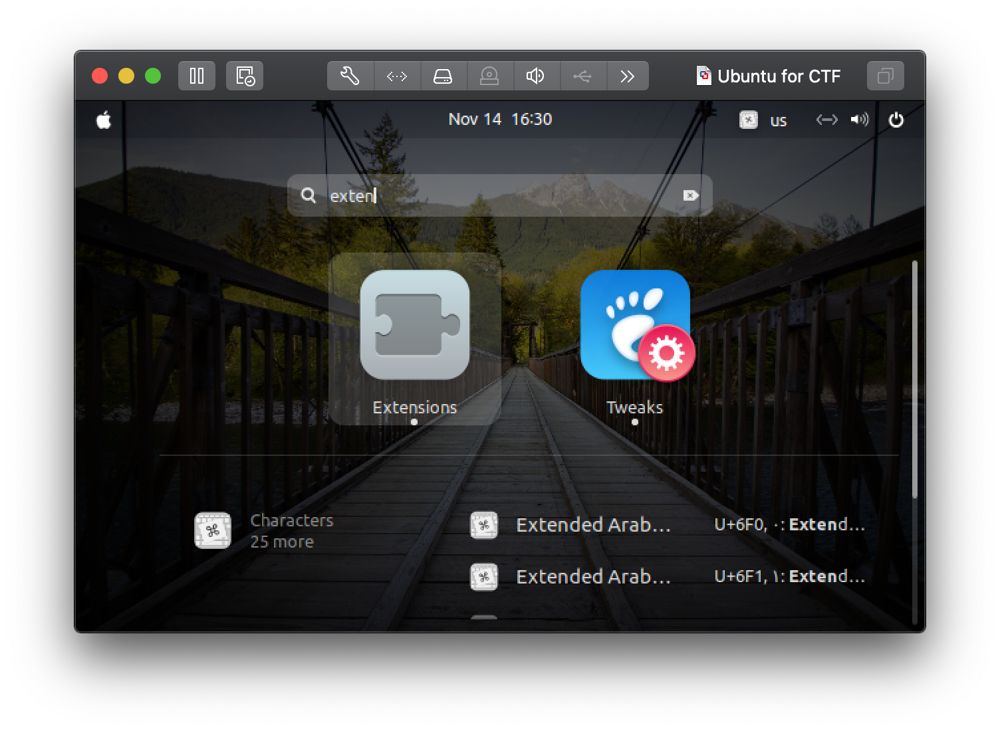
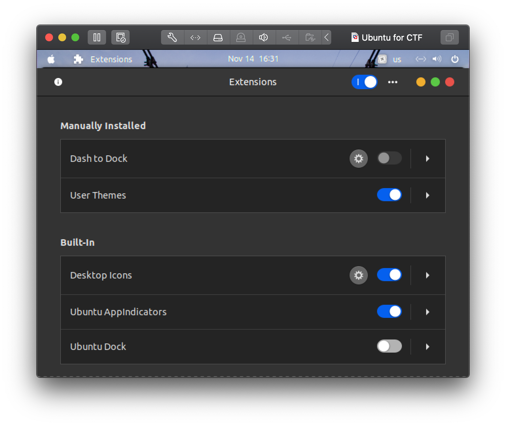

## About

That is my Linux(Ubuntu, Kali) and Mac OS setting.

## Install

| Script | Target |
| --- | --- |
| `install-macos.sh` | macOS (Homebrew 필요) |
| `install-ubuntu.sh` | Ubuntu, 일반 사용자 (sudo 필요) |
| `install-ubuntu-root.sh` | Ubuntu, root |
| `install-kali.sh` | Kali Linux, 일반 사용자 (sudo 필요) |

모든 스크립트는 `bash`로 실행합니다. `sh`(dash)로 실행하면 문법 오류가 납니다.
설치 중 입력을 묻지 않고, 다시 실행해도 이미 설치된 항목은 건너뜁니다. 실패한 부가 도구는 마지막에 목록으로 알려 주며, 다시 실행하면 그 항목만 재시도합니다.

In Mac OS

    wget https://raw.githubusercontent.com/crookedsystem/dotfiles/main/install-macos.sh
    bash install-macos.sh

Setting for Users (Ubuntu)

    wget https://raw.githubusercontent.com/crookedsystem/dotfiles/main/install-ubuntu.sh
    bash install-ubuntu.sh

- `sudo` 비밀번호는 시작할 때 입력합니다. 이후 단계는 입력 없이 진행되지만, 단계 사이가 sudo 캐시 시간(기본 15분)을 넘으면 다시 물을 수 있습니다. 비밀번호 없는 sudo(`NOPASSWD`)를 설정하면 끝까지 무입력입니다.
- 설치 순서: apt 패키지 → 로케일·ssh → Homebrew와 도구 → Rust·nvm → Docker → oh-my-zsh·플러그인·fzf·dotfiles → crookedsystem/nvim 설정·의존성 → 기본 셸 변경
- 설치 중 zsh로 진입하지 않습니다. 설치가 끝나면 `exec zsh`를 실행하거나 다시 로그인하세요. 기본 셸 변경과 `docker` 그룹은 다음 로그인부터 적용됩니다.
- `zshrc.linux`는 `~/.zshrc`로 복사됩니다 (macOS는 `zshrc.macos`).

In root (Ubuntu)

    su root
    wget https://raw.githubusercontent.com/crookedsystem/dotfiles/main/install-ubuntu-root.sh
    bash install-ubuntu-root.sh

Kali Linux

    wget https://raw.githubusercontent.com/crookedsystem/dotfiles/main/install-kali.sh
    bash install-kali.sh

## 설정 파일 적용

저장소 루트에서 설정을 `~/.config/`에 복사합니다.

```bash
mkdir -p ~/.config
cp -R config/. ~/.config/
```

`~/.config`가 없으면 `cp -r config ~/.config`도 사용할 수 있습니다. 이미 있으면 이 명령은 `~/.config/config/`를 만들므로 위 명령으로 내용을 복사합니다.

AeroSpace는 `~/.config/aerospace/aerospace.toml`, tmux는 `~/.config/tmux/tmux.conf`에 배치됩니다. 기존 `~/.aerospace.toml`이나 `~/.tmux.conf`가 있으면 백업 후 새 경로로 설정을 합쳐, 이전 파일과 중복되거나 이전 설정이 우선 적용되지 않도록 합니다.

Ghostty와 workmux도 각 도구의 폴더에 복사됩니다. Coolify는 서버용 템플릿이므로 [별도 적용 절차](./config/coolify/README.md)를 따릅니다.

## TMUX 사용법

[열기](./docs/TMUX.md)

### TPM (Tmux Plugin Manager) 설치

tmux 플러그인 관리를 위해 TPM을 설치해야 합니다.

    git clone https://github.com/tmux-plugins/tpm ~/.tmux/plugins/tpm

설치 후 tmux에서 `prefix + I`를 눌러 플러그인을 설치합니다.

## Docs

- [AeroSpace](./docs/how-to-use-aerospace.md)
- [Tailscale Exit Node](./docs/TAILSCALE.md)
- [Herdr](./docs/HERDR.md)

### mkdocs

```console
pip3 install mkdocs
pip3 install mkdocs-material
mkdocs serve --dev-addr 0.0.0.0:8080
```

It's working in mac

## VMware Workstationd 관련 CLI

`workstationd`는 보통 직접 조작하는 메인 CLI라기보다 VMware Workstation의 백그라운드 서비스에 가깝습니다. 실제로 자주 쓰는 명령은 VM 제어용 `vmrun`, 컨테이너 런타임용 `vctl`, 그리고 호스트 점검용 `vmrest`/`vmware-modconfig` 쪽입니다.

### 1. VM 제어: `vmrun`

`vmrun`은 가상 머신 전원, 스냅샷, 게스트 내부 명령 실행까지 자동화할 때 가장 먼저 보는 CLI입니다.

```bash
# 실행 중인 VM 목록
vmrun list

# GUI 없이 VM 시작/종료
vmrun start "/path/to/my.vmx" nogui
vmrun stop "/path/to/my.vmx" soft

# 스냅샷 생성/복구
vmrun snapshot "/path/to/my.vmx" before-test
vmrun revertToSnapshot "/path/to/my.vmx" before-test

# 게스트 OS 내부에서 프로그램 실행
vmrun -gu guestUser -gp guestPassword runProgramInGuest \
  "/path/to/my.vmx" /usr/bin/id
```

핵심 포인트:

- VM 전체 lifecycle 제어에 적합합니다.
- 스냅샷 기반 테스트, 게스트 내부 스크립트 실행, 파일 복사 자동화에 유용합니다.
- Docker 기준으로 보면 `docker`처럼 컨테이너를 다루는 도구라기보다, 전체 머신을 제어하는 `virsh`/`VBoxManage` 쪽에 더 가깝습니다.

### 2. Docker와 가장 가까운 CLI: `vctl`

`vctl`은 Workstation Pro 안에서 컨테이너를 다루는 CLI입니다. Docker와 가장 직접적으로 비교되는 명령군도 이쪽입니다.

```bash
# 컨테이너 런타임 시작
vctl system start

# 이미지/컨테이너 조회
vctl images
vctl ps

# 컨테이너 실행
vctl run --name web -d nginx

# Dockerfile 기반 이미지 빌드
vctl build --file Dockerfile --tag docker.io/me/app:1.0 .

# 컨테이너를 담고 있는 CRX VM 내부 셸 접속
vctl execvm --sh -c web

# KIND 환경 준비
vctl kind
```

핵심 포인트:

- `vctl run`, `vctl ps`, `vctl build`, `vctl pull`, `vctl push`, `vctl login`은 각각 `docker run`, `docker ps`, `docker build`, `docker pull`, `docker push`, `docker login`과 거의 1:1로 대응됩니다.
- 차이는 `vctl`이 컨테이너를 그냥 host namespace에서 실행하는 것이 아니라, 각 컨테이너를 `CRX VM`이라는 경량 VM 안에서 돌린다는 점입니다.
- 그래서 Docker보다 VM 경계가 더 강하고, 반대로 네트워크/볼륨 기능은 더 제한적입니다.

### 3. Docker와의 대응 관계

| VMware Workstation CLI | Docker에서 대응되는 개념 | 설명 |
| --- | --- | --- |
| `vmrun start/stop/snapshot` | 직접 대응 없음 | VM 전체를 다루는 명령입니다. 컨테이너보다 훨씬 큰 단위입니다. |
| `vctl run` | `docker run` | 이미지를 기반으로 컨테이너를 실행합니다. |
| `vctl ps` | `docker ps` | 실행 중인 컨테이너 또는 전체 컨테이너를 조회합니다. |
| `vctl build` | `docker build` | Dockerfile로 이미지를 빌드합니다. |
| `vctl exec` | `docker exec` | 실행 중인 컨테이너 내부 명령을 실행합니다. |
| `vctl execvm` | 대응 없음 | 컨테이너가 아닌, 그 컨테이너를 담고 있는 CRX VM 자체로 들어갑니다. |
| `vctl kind` | Docker 기반 `kind` 대체 | `kind`가 Docker 대신 `vctl` 컨테이너를 node로 사용하게 만듭니다. |

실무적으로는 이렇게 이해하면 편합니다.

- VM 자동화가 필요하면 `vmrun`
- Docker와 비슷한 UX로 컨테이너를 돌리고 싶으면 `vctl`
- 다만 `vctl`은 내부적으로 Docker Engine이 아니라 `containerd + CRX VM` 모델을 사용합니다.

### 4. `vctl`이 Docker와 다른 점

- `vctl system start`로 container runtime을 먼저 올립니다.
- 컨테이너마다 경량 VM(CRX VM)이 붙기 때문에 Docker보다 격리가 강합니다.
- 공식 문서 기준 `--publish`로 host port를 바인딩하는 방식이 핵심이며, Docker의 subnet/link 같은 기능은 없습니다.
- `--volume`은 폴더의 절대 경로만 지원하고, named volume도 제한적입니다.
- `vctl kind`를 실행하면 `docker.exe` shortcut을 `vctl.exe`로 연결해 KIND 워크플로우를 대체할 수 있습니다.

### 5. 이 호스트에서 같이 보이는 보조 명령

현재 Linux 호스트에서 확인된 보조 명령은 다음과 같습니다.

```bash
# REST API 서버 옵션 확인
vmrest -h

# 커널 모듈/빌드 환경 점검용
vmware-modconfig --help

# VMware 백그라운드 서비스 상태 확인/재시작
systemctl status vmware.service
sudo systemctl restart vmware.service
```

간단히 정리하면:

- `vmrest`: REST API 서버를 띄울 때 보는 명령
- `vmware-modconfig`: 커널 헤더/GCC 환경과 VMware 모듈 재구성 관련 명령
- `systemctl ... vmware.service`: Linux에서 VMware 백그라운드 서비스를 관리할 때 사용하는 호스트 명령

### 6. `vmrun`으로 SSH 접속할 수 있나?

짧게 말하면 `직접 SSH 접속하는 기능은 없습니다`.

- `vmrun`의 guest 제어는 SSH가 아니라 `VMware Tools` 기반입니다.
- 그래서 인증도 SSH key/host/port가 아니라 `-gu`, `-gp`로 guest 계정을 넘기는 방식입니다.
- 즉 `ssh user@guest`를 대체하는 도구라기보다, host에서 guest 안의 프로그램이나 스크립트를 실행하는 자동화 도구에 가깝습니다.

대신 아래 흐름은 가능합니다.

```bash
# guest IP 확인
vmrun getGuestIPAddress "/path/to/my.vmx" -wait

# 확인한 IP로 일반 ssh 접속
ssh user@<guest-ip>
```

또는 NAT/포트포워딩을 쓰는 경우에는 `vmrun`으로 포워딩을 잡고, 실제 접속은 SSH 클라이언트로 합니다.

```bash
# 예시: host 2222 -> guest 22
sudo vmrun setPortForwarding vmnet8 tcp 2222 192.168.***.*** 22 ssh-vm

# 실제 접속은 ssh 사용
ssh -p 2222 user@127.0.0.1
```

### 참고 자료

- [`vmrun` 개요 - Broadcom](https://techdocs.broadcom.com/us/en/vmware-cis/desktop-hypervisors/workstation-pro/17-0/using-vmware-workstation-pro/using-the-vmrun-command-to-control-virtual-machines.html)

  > "control virtual machines and automate guest operations"

- [`vmrun` 문법 - Broadcom](https://techdocs.broadcom.com/us/en/vmware-cis/desktop-hypervisors/workstation-pro/17-0/using-vmware-workstation-pro/using-the-vmrun-command-to-control-virtual-machines/syntax-of-the-vmrun-command.html)

  > "authentication flags, commands, and parameters"

- [`vctl` 개요 - Broadcom](https://techdocs.broadcom.com/us/en/vmware-cis/desktop-hypervisors/workstation-pro/17-0/using-vmware-workstation-pro/using-vctl-command-to-manage-containers-and-run-kubernetes-cluster.html)

  > "to manage containers"

- [`vctl` 문법/기능 - Broadcom](https://techdocs.broadcom.com/us/en/vmware-cis/desktop-hypervisors/workstation-pro/17-0/using-vmware-workstation-pro/using-vctl-command-to-manage-containers-and-run-kubernetes-cluster/running-vctl-commands/syntax-of-vctl-commands.html)

  > "Builds a container image using a Dockerfile"

- [`vctl`와 KIND, Docker 대체 - Broadcom](https://techdocs.broadcom.com/us/en/vmware-cis/desktop-hypervisors/workstation-pro/17-0/using-vmware-workstation-pro/using-vctl-command-to-manage-containers-and-run-kubernetes-cluster/enabling-kind-to-use-vctl-container-as-nodes-to-run-kubernetes-clusters.html)

  > "It enables KIND to use vctl container instead of Docker container as nodes to run local Kubernetes clusters."

- [`vctl` 추가 설명 - VMware Archive](https://raw.githubusercontent.com/vmware-archive/vctl-docs/master/README.md)

  > "vctl allows users to Build, Run, Push and Pull containers and images, manage the system runtime settings, and configure the environment to support 'kind'."

## Setting

Timezone Setting (Korea)

    sudo ln -sf /usr/share/zoneinfo/Asia/Seoul /etc/localtime

Ubuntu Dock Hide


